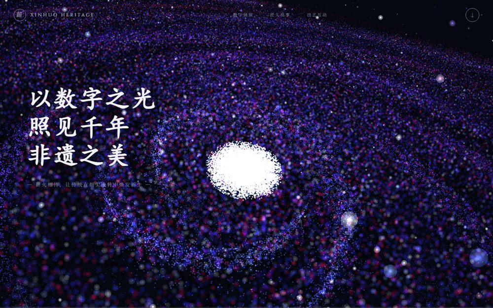
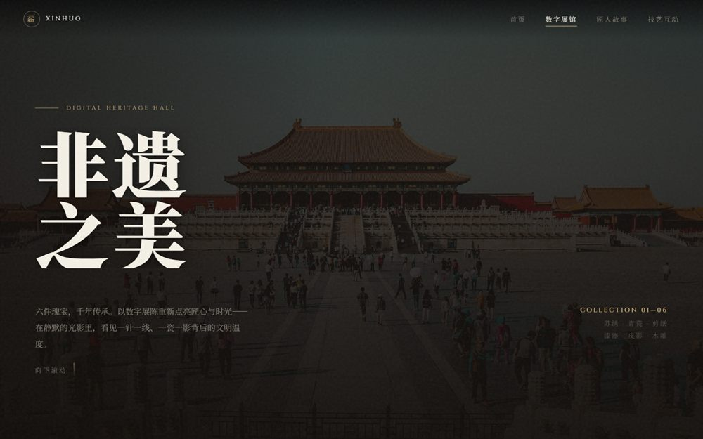
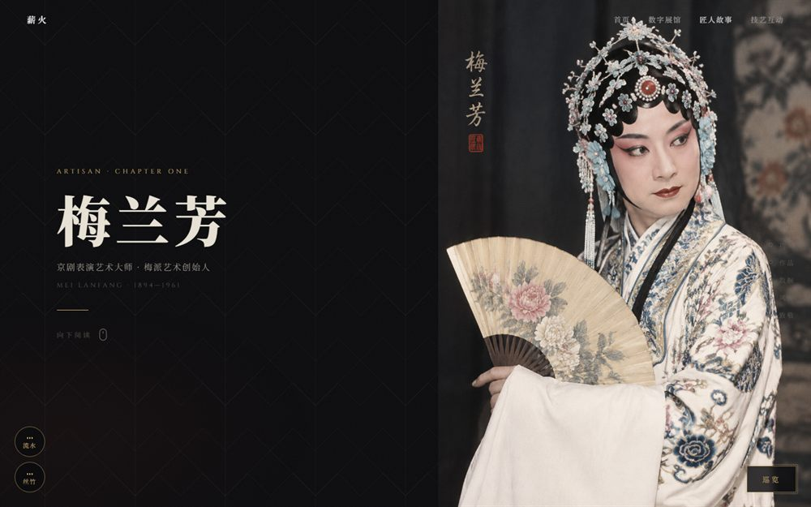
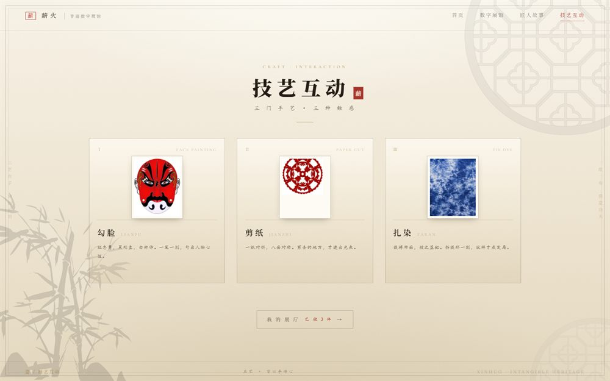
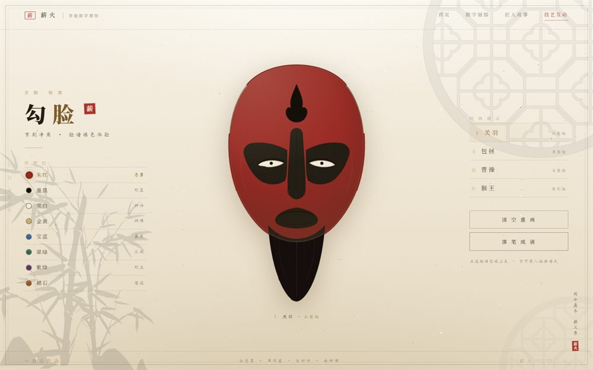
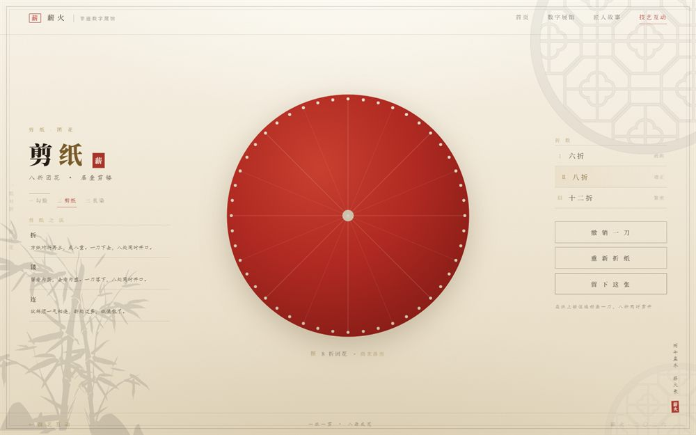
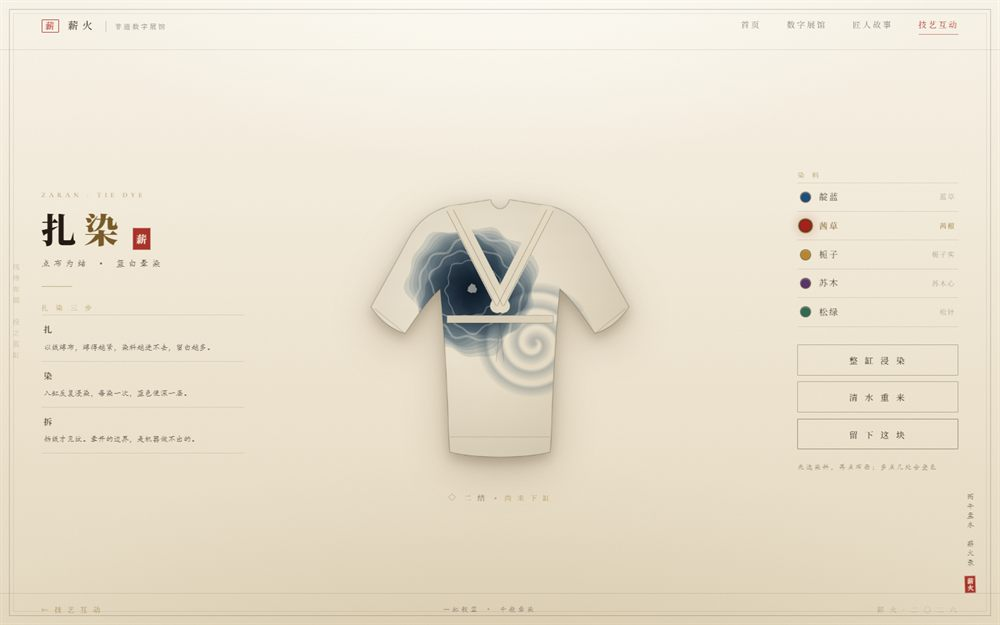
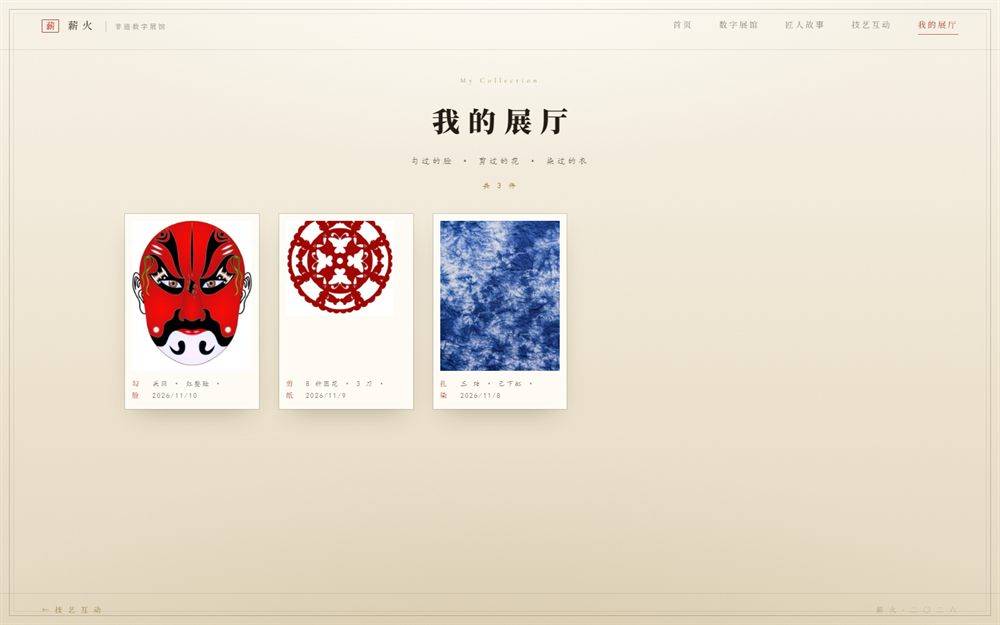

# 薪火 · 非遗数字展馆

一个用网页做的非遗展馆。**看得见**的部分是六件馆藏和三位匠人，**摸得着**的部分是京剧脸谱、剪纸、扎染三样手艺——都能自己在页面上做一遍，做完还能留下来。

> 零杯网页设计比赛 · 主题二「匠心传承，非遗焕新」



---

## 页面

| 页面 | 路径 | 说明 |
| --- | --- | --- |
| 首页 | `public/index.html` | 银河粒子背景，一句话立住主题 |
| 数字展馆 | `public/hall.html` | 六件非遗馆藏：苏绣、青瓷、剪纸、漆器、皮影、木雕 |
| 匠人故事 | `public/craftsman.html` | 梅兰芳、王天问、姚建萍三位匠人的长篇叙事 |
| 技艺互动 | `public/easter-egg.html` | 三门手艺的入口 |
| └ 勾脸 | `public/lianpu.html` | 京剧净角脸谱设色 |
| └ 剪纸 | `public/jianzhi.html` | 八折团花，鼠标直接剪 |
| └ 扎染 | `public/zaran.html` | 中式上衣，点布下结 |
| 我的展厅 | `public/gallery.html` | 你做的作品都收在这里 |




---

## 三门手艺



### 勾脸 —— 脸谱设色

一张脸谱拆成 **11 个可上色区块**：额心、左右额角、左右眼窝、左右颧、左右腮、鼻窝、嘴窝。

- 8 种传统色，每种都带一句色义（朱红·忠勇、墨黑·刚直、雪白·奸诈……）
- 4 个经典谱式一键套用，上色时依次扫过
- 落笔的一瞬间，墨会从点击处**洇开**再收掉
- 鼠标停在某个区块上，下方浮出这个部位的术语与讲究
- 「落笔成谱」生成一张作品卡，带判词，可导出 PNG



### 剪纸 —— 八折团花

不是点选预设，是**真的用鼠标剪**。

- 在纸上按住拖动画一笔，八折的八层同时被剪开，镂空处透出纸色
- 六折 / 八折 / 十二折可切换
- 红纸上有 16 道极淡的折痕——那是折过的痕迹
- 撤销一刀、重新折纸、留下这张



### 扎染 —— 一缸靛蓝

布不是一块方布，是一件**中式交领上衣**：立领、系带、弧线衣摆。

- 5 种草木染料：靛蓝、茜草、栀子、苏木、松绿
- 点衣服的任意位置放下一个「结」，染料从结心晕开
- 三种晕法轮换：同心晕、螺旋晕、云染
- 染液被裁在衣形之内，花纹会顺着领口和袖口断开
- 「整缸浸染」铺一层底色水痕



---

## 我的展厅

三个页面点「留下这张」时，作品会同时存进浏览器本地，攒成一整面墙。关掉页面再回来还在。



---

## 技术

全部是**原生 HTML / CSS / JavaScript**，没有框架、没有构建步骤。

- **Three.js** —— 首页银河粒子（21 万点）、勾脸页的光尘
- **Canvas 2D** —— 扎染的晕染（`multiply` 叠色 + 不规则环形）、作品卡合成导出
- **SVG** —— 脸谱的 11 个区块、剪纸的遮罩镂空
- **Web Audio** —— 匠人页的流水与丝竹
- **localStorage** —— 我的展厅
- **响应式** —— 980px / 520px 两档断点，移动端重排

细节上还做了：`prefers-reduced-motion` 降级、键盘可聚焦、图片 `alt`、页面之间的宣纸过场。

---

## 本地运行

```bash
npm run dev
# 打开 http://127.0.0.1:7100
```

或者不用 Node：

```bash
cd public && python -m http.server 7100
```

> 直接双击 HTML 也能浏览，但**导出 PNG / 保存作品**在 `file://` 下会被浏览器的画布安全策略挡住。要演示保存功能，请用上面的方式起一个本地服务。

---

## 目录结构

```
.
├── public/
│   ├── index.html          首页
│   ├── hall.html           数字展馆
│   ├── craftsman.html      匠人故事
│   ├── easter-egg.html     技艺互动入口
│   ├── lianpu.html         勾脸
│   ├── jianzhi.html        剪纸
│   ├── zaran.html          扎染
│   ├── gallery.html        我的展厅
│   ├── css/  js/  fonts/   样式、脚本、本地字体
│   ├── images/             馆藏与手艺素材
│   └── audio/              环境音
├── docs/screenshots/       本文件用到的截图
├── server.js               极简静态服务器
└── package.json
```

---

## 离线也能用

比赛的机器不一定联网，所以：

- 字体用本地 `woff2` 子集（`public/fonts/`），Google Fonts 只作为生僻字兜底
- Three.js、GSAP、ScrollTrigger 都是本地文件，不走 CDN
- 断网时页面版式和动效不受影响

---

## 素材说明

- 照片、脸谱图、剪纸与扎染的实拍素材来自公开网络，仅用于课程作业与比赛展示
- 页面中的矢量图形、交互与代码为团队原创

如用于商业用途，请替换素材或取得授权。

---

## 团队

零杯参赛队 · 薪火
